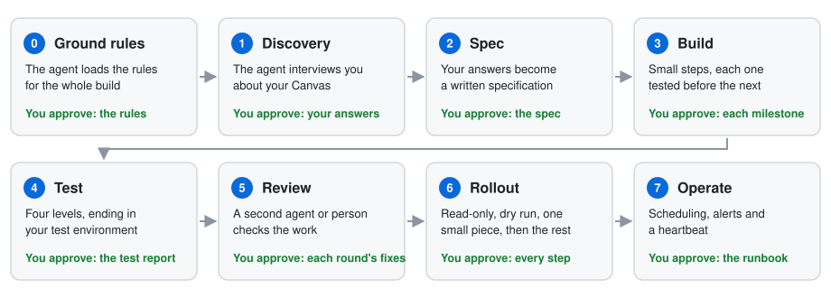

# termwright-kit

**Eight prompts that make your own AI coding agent build, test and roll out a tool that sets up a term's courses in Canvas.**

This is a prompt kit, not a program. You paste the prompts into an AI coding agent, such as
Claude Code or Codex, and it interviews you, writes a spec, and builds the tool for **your**
Canvas (Instructure's learning management system), in whatever language fits your systems.

## The problem

Before each term, someone has to turn a course list into Canvas: create the courses and sections
with the right IDs, enrol the right instructors, copy last term's content and switch on the right
tools. Done by hand, it is slow and repeated every term. Done by a script, it is fast until the
script quietly does something wrong to hundreds of courses at once.

The kit is built around the second worry. The tool it produces plans every write first, shows you
the plan, waits for your approval, applies it in small batches, and can say exactly what it did.

## How it works

<picture>
  <source media="(prefers-color-scheme: dark)" srcset="docs/img/kit-steps-dark.svg">
  
</picture>

Work through the files in order. Each one is a prompt you paste to the agent, and each tells the
agent when to stop and wait for you.

| Step | File | What happens | You approve |
| --- | --- | --- | --- |
| 0 | [`00-ground-rules.md`](00-ground-rules.md) | The agent loads twenty rules for the whole build | The rules, plus your own |
| 1 | [`01-discovery.md`](01-discovery.md) | The agent interviews you about your Canvas | Your answers |
| 2 | [`02-spec.md`](02-spec.md) | Your answers become a written specification | The spec |
| 3 | [`03-build.md`](03-build.md) | The agent builds in small tested steps | Each milestone |
| 4 | [`04-test.md`](04-test.md) | Tests at four levels, ending in your test environment | The test report |
| 5 | [`05-review.md`](05-review.md) | A second agent or a person reviews the work | Each round's fixes |
| 6 | [`06-rollout.md`](06-rollout.md) | Read-only, dry run, one small piece live, then the rest | Every step |
| 7 | [`07-operate.md`](07-operate.md) | Scheduling, alerts, a heartbeat and failure handling | The runbook |

Paste the ground rules first, and keep them in the agent's instructions file (`CLAUDE.md` for
Claude Code, or your agent's equivalent) so they apply to every later step.

[`examples/`](examples/) holds short, generic illustrations: an API call with paging, a config
file, a dry-run report and a test stub. They show the shape of things. They are not a working tool.

## What the rules protect

The twenty ground rules are the part that matters most. A few of them:

- **Plan, approve, apply, verify.** Every write goes through a plan you can read and refuse.
- **The agent can never approve its own plan.** Approval is a deliberate action by a person.
- **A fixed list of write actions.** There is no generic "send any request".
- **No deletes** outside a separate, reviewed undo path.
- **No emails or notifications from a test environment,** enforced in code.
- **Secrets stay out** of the repository, the logs and the chat.

## Who this is for

- A Canvas administrator or learning-technology person who can describe how their Canvas is set
  up and can approve changes.
- Someone with an AI coding agent and basic comfort with a terminal.

You do **not** need to be a programmer. You do need to read plans and answer questions, and the
agent will ask a lot of them.

Many institutions already have this automated, with middleware and developers. Many more do not,
and plenty of Canvas administrators still build each term by hand. The kit is for them. It is not
tied to a Mac or to Python.

## What you need

1. **An AI coding agent** that can read and write files in a project folder and run commands.
2. **A Canvas test or beta environment** you may write to. Do not start on production.
3. **A Canvas API token** for the test environment first, with the least permission that works.
   Keep it out of the project folder.
4. **Your starting data,** such as a registrar's course list or an export from your student
   information system.
5. **Permission** from whoever owns your Canvas to create courses and enrol people through the API.

## Why prompts and not code

The tool this kit came from was built around one university's Canvas: its accounts, its course and
section naming, its roles, its vendors and its forms. It would not work anywhere else, and this
kit contains none of its code.

A script carries the assumptions of the place it was written. Prompts carry the questions that
surface yours, and the ground rules that keep the result safe.

## Time and cost

- The original tool reached its first full run in about three days of intensive work, with
  refinements over the following week. A narrower tool will be much quicker.
- Expect heavy use of your agent's usage allowance. The original build used most of a plan's
  allowance in about a day, which is why the kit tells the agent to use cheaper models for
  mechanical work and to run one task at a time.
- Canvas test environments are often rate limited far below production. Budget time for that.

## Honest limits

- **This is a method, not a product.** The agent writes your tool. You own it, and you are
  responsible for what it does.
- **The agent will make mistakes.** The kit is designed so they are found in tests, plans and
  reviews, not in production. It cannot guarantee that.
- **Your Canvas is different.** The discovery questions come from places where the original
  depended on one institution's set-up. Expect more that the kit did not think of.
- **The original had no independent review.** Its first production mistake was caught by a person
  reading a plan. [`05-review.md`](05-review.md) is what this kit asks for and the original lacked.
  It is written from principles, not from review rounds that were run.
- **A review is only as independent as you make it.** A second agent that reads the first agent's
  summary is not independent. Make sure the reviewer reads the code.
- **Some behaviour was never tested live in the original,** such as production notifications and
  rate-limit storms. The kit tells the agent to treat those as unknown until proven.
- **Third-party platforms change.** Ask the agent to check current documentation and to mark
  anything it could not verify.

## Credit

Written by Kamal Taynaz from the build of a real term-setup tool. The credit belongs to the
process: a written spec before code, ground rules with reasons, staged testing and an
approval-gated rollout. The prompts are original text written for this kit.

More of my write-ups are at [taynaz.com](https://taynaz.com).

## Licence

MIT. See [LICENSE](LICENSE).
